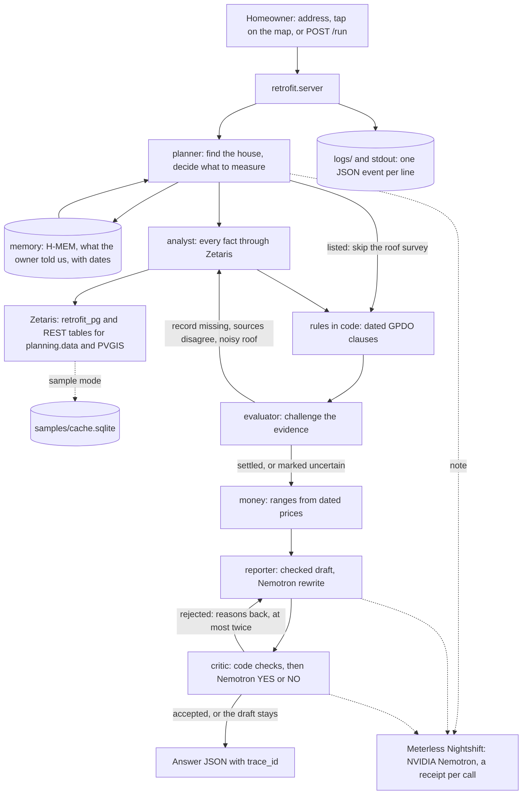

# Retrofit Check

**Is my house eligible for solar panels?** Know what's possible, what it costs and what to do next, for your house.

> Track: Solving Fragmented Intelligence (Track 1), Open Agent Hackathon 2026, team Buccies (solo)
> Sponsor technology: Zetaris (data layer), Meterless H-MEM (engine) and Nightshift (AI provider), NVIDIA Nemotron
> Run without keys: `SAMPLE_MODE=true .venv/bin/python -m retrofit.server`, then open http://localhost:5173 or `POST /run`. Any house in England works; a new house needs an internet connection

[](https://github.com/slowturtle1/retrofit-check/actions/workflows/tests.yml)
Scorecard against the HackOS APPROACH guide and judging criteria: [`approach/report.md`](approach/report.md) (run `make approach`)

## 1. Problem

A homeowner in England who wants solar panels has to find out three things: whether the panels are allowed, whether the roof is worth it, and what to do next. The answer is spread over separate sources. The listing and the conservation area are on planning.data. The council's own Article 4 decisions are on its website, and they do not always match planning.data. The law is on legislation.gov.uk, the roof is in Environment Agency LIDAR, the sun is in PVGIS, the roads are in OpenStreetMap, and the prices come from Ofgem and DESNZ. Today the owner pieces this together by hand, or pays someone to.

We are building an agent that helps a homeowner in England decide whether to get quotes for solar panels by reconciling planning records, the council's Article 4 decisions, national rules, roof measurements and prices through Zetaris, producing one answer with a status, the reason, the rule and its date, rough money, a confidence level, its limits and one next step.

One user (an owner occupier of a house in England), one decision (is it worth getting quotes, or do I ask the council first), one output (the solar answer, with a source behind every fact).

## 2. Agents

Every trace event names the agent that acted. The status itself always comes from the rules in code (`retrofit/rules.py`), never from a model.

| Agent | Responsibility | Can block or retry |
|---|---|---|
| `planner` | Finds the building, recalls what the owner told us, reads the owner's note (Nemotron), and decides what is worth measuring: planning first, so a listed building skips the roof survey | Yes: stops early for a listed building; an unknown house gets a clear message |
| `analyst` | Reads every fact through Zetaris; registers planning.data and PVGIS as Zetaris REST tables per house | Yes: queries again when the evaluator challenges; measures a noisy roof again with a wider margin; goes direct if Zetaris cannot reach a source, and says so; in sample mode, fetches a house outside the snapshot straight from the public sources |
| `evaluator` | Challenges the evidence behind the first answer: a missing Article 4 record, a listing found only as a point, two sources that disagree, one cost figure that hides the spread, one share of solar power used at home that hides who is home in the day, a house planning.data shows as not listed (checked against Historic England's own outlines) | Yes: sends the analyst back to Zetaris; marks the answer uncertain when the new query does not settle it, and a listed outline that planning.data lacks gives "Check with the council" |
| `reporter` | Writes the checked draft from the evidence; Nemotron rewrites it in plain words | Yes: rewrites with the critic's reasons, at most twice |
| `critic` | Checks the rewrite in code (no new numbers, place names kept, status not softened), then asks Nemotron YES or NO | Yes: blocks a rewrite; after two rejections the checked draft stays |
| `memory` | H-MEM keeps what the owner told us, with the date, and supersedes it on a correction | No |

## 3. What makes this an agent system

- The evaluator does not trust a missing record. "No Article 4 on record" is only accepted after the analyst asks Zetaris whether the council publishes conservation area Article 4s at all. Camden does; Haringey has published none, so there the answer says to ask the council.
- planning.data holds most listings as points, so a house it shows as not listed is checked against Historic England's own listed building outlines, read live through Zetaris as a REST table. An outline that planning.data lacks gives "Check with the council".
- When sources disagree, the agent shows both. planning.data still lists Hampstead's Article 4 A4Ha1 with no end date; Camden ended it on 9 Jun 2026, and the agent follows the council.
- The planner branches: a listed building stops before the roof survey: consent is needed whatever the roof is like.
- The critic sends a rejected rewrite back to the reporter with the reasons. The critic can also block it, and then the owner sees the checked draft.
- Memory changes the answer. The owner's yearly electricity use, given once, is recalled on the next visit and compared with what the roof makes. A correction changes the answer and keeps the old value as history.
- The money is challenged too. How much of the roof's output a home uses itself depends on who is home in the day, so the evaluator asks the MCS tables for all three occupancy types and the answer shows the range.
- If the rules say "allowed" but the council's records are incomplete, the answer says "Check with the council", with the reason.
- If Zetaris cannot reach planning.data or PVGIS, the same request goes direct and the trace says so. If Nightshift fails, the checked draft stays.



## 4. Tech stack

| Component | Technology |
|---|---|
| API and page | FastAPI (`retrofit/server.py`), server sent events for the live trace |
| Agents | Python (`retrofit/agent/`), rules in plain code (`retrofit/rules.py`) |
| Data layer | Zetaris: Postgres datasource `retrofit_pg` over JDBC, Lightning REST tables, Lightning SQL |
| Cache database | Postgres in Docker on the Zetaris network (`docker-compose.yml`) |
| Memory | Meterless H-MEM reference engine behind a small HTTP service (`hmem/server.ts`, Node) |
| Model runtime | Meterless Nightshift (OpenAI compatible, local) |
| Model | NVIDIA Nemotron 3.5 Lightning, pinned: `nvidia/nemotron-3.5-lightning-30b-a3b` |
| Map | CesiumJS with Google Photorealistic 3D Tiles (optional key), OpenStreetMap without it |
| Logs | JSON lines in `logs/` and one line per event on stdout |
| Development | Claude Code |

## 5. Setup

### Sample mode (no keys, about a minute)

```bash
git clone https://github.com/slowturtle1/retrofit-check && cd retrofit-check
python3 -m venv .venv && .venv/bin/pip install -r requirements.txt
SAMPLE_MODE=true .venv/bin/python -m retrofit.server      # http://localhost:5173
```

No `.env`, Zetaris, Nightshift, H-MEM or keys. The agent runs its real logic (planner, rules, evaluator challenges, money, the critic's code checks) on a snapshot of the Zetaris tables in `samples/cache.sqlite` for 15 houses (the six below and the evaluation houses): the same SQL it sends to Zetaris, answered locally. No answers are stored; each one is computed again. Without Nightshift the text is the checked draft from the rules. Any other house in England works too, still without keys. The agent fetches it straight from OpenStreetMap, planning.data, Environment Agency LIDAR and PVGIS, keeps it in `runs/live-cache.sqlite` and reads it back with the same SQL. The trace marks this as a fallback, because Zetaris is not in the path; with the full stack the same data goes through Zetaris. An address search snaps to the nearest building within 20 m. We tried houses in Bristol (Horfield), Bath (Royal Crescent), Hebden Bridge (Grade II listed, so consent) and Manchester (Withington). `DIRECT_SOURCES=false` keeps sample mode to the snapshot only.

### Live mode

Needs Docker with Zetaris running locally, Meterless Nightshift with an NVIDIA key, Python 3.12+ and Node 20+. Zetaris and Nightshift are set up as in the organisers' Participant Setup Guide.

```bash
cp .env.example .env                      # fill in the Zetaris key, the Nightshift token and a database password
python3 -m venv .venv && .venv/bin/pip install -r requirements.txt
docker compose --env-file .env up -d      # cache database on the Zetaris network
.venv/bin/python scripts/setup_zetaris.py # register it in Zetaris
(cd hmem && npm install && npm run setup && npm start &)   # H-MEM on :8790
.venv/bin/python -m retrofit.server       # http://localhost:5173
```

The NVIDIA key goes into Nightshift (Setup, Providers), not into `.env`. The Google key is optional and only draws the 3D city.

## 6. Usage

On the page: type a postcode or pick an example, tap the roof, and the answer appears while the trace shows each step.

From code:

```bash
curl -s -X POST http://localhost:5173/run -H 'content-type: application/json' \
  -d @input_examples/dartmouth.json
```

`POST /run` and `POST /api/v1/check` are the same endpoint. Request:

```json
{ "way": 1106478076, "label": "Dartmouth Park, NW5" }
```

Input: an OpenStreetMap way id (`way`) or a point on the roof (`lat`, `lon`); optional `elec_kwh` (your yearly electricity use, from the bill), `note` (free text the agent reads) and `use_model` (true to have Nemotron rewrite the text; it can take minutes).

Response (abridged, a real sample mode run for house F):

```json
{
  "schema": "1",
  "trace_id": "20261025T195942-aac30d",
  "mode": "sample",
  "question": "Is my house eligible for solar panels?",
  "solar": {
    "status": "allowed",
    "status_text": "Allowed under permitted development",
    "rules_status": "allowed",
    "recommendation": "Worth getting quotes",
    "confidence": { "score": 0.9, "level": "high", "because": ["sources agree"],
                    "text": "High: the listing, conservation area and Article 4 records agree, and the roof reading is clean (11% trees or chimneys)." },
    "numbers": { "kwp": 2.9, "kwh_year": 2916, "facing": "S",
                 "cost_gbp": [4600, 6100], "value_gbp_year": [280, 530], "payback_years": [9, 22] },
    "rules": [{ "id": "solar-pitched", "clause": "GPDO Sch 2 Part 14 Class A, A.2(c)",
                "in_force": "2015-04-15", "amended_by": "SI 2026/896 (27 Aug 2026)",
                "source_url": "https://www.legislation.gov.uk/uksi/2015/596/schedule/2/part/14" }],
    "facts": [{ "fact": "conservation-area", "value": "Dartmouth Park (CA9, since 1992-06-01)",
                "source": "planning.data conservation-area", "date": null }],
    "limitations": ["The share of solar power used at home follows the MCS tables for 2,500 kWh a year (a typical home, Ofgem); your own pattern may differ.",
                    "Rules for England, demo data for London."],
    "next_step": "Get quotes from two or three MCS certified installers. If you want it in writing, apply to Camden for a lawful development certificate.",
    "usage": null,
    "lines": { "one": "...", "why": "...", "get": "...", "cost": "..." }
  },
  "house_facts": [{ "key": "listed", "label": "Listed", "value": "Not listed", "source": "Historic England, via planning.data" }],
  "trace": { "file": "logs/trace-20261025T195942-aac30d.jsonl", "zetaris_queries": 14,
             "agents": ["analyst", "evaluator", "memory", "planner", "reporter"] }
}
```

`house_facts` always holds the same 7 facts in the same order: listed, conservation area, Article 4, walls facing a road, roof direction and slope, sun on the roof, and your electricity use. `rules_status` is what the rules alone say; `status` can be more careful, for example "Check with the council" when the council has not published its Article 4 directions. `usage` compares the owner's yearly electricity use with what the roof makes, once they have given it. The full contract is in `retrofit/schema.py`.

The recommendation is decided in code (`retrofit/money.py`). The yearly value uses the MCS share of solar power used at home, for the owner's own electricity use when they have given it and for Ofgem's typical 2,500 kWh otherwise. "Worth getting quotes" needs the typical payback to fit within the panels' life of about 25 years. A roof that is very small or gets little sun is "Probably not worth it for this house", and an open legal question means "Ask the council first". Three inputs and their saved real outputs are in [`input_examples/`](input_examples/) and [`output_examples/`](output_examples/). The output examples are copies of real runs for reading; the app never returns them.

## 7. Sample houses

| House | What it shows |
|---|---|
| Dartmouth Park, NW5 (house F): corner house, not listed, Dartmouth Park Conservation Area since 1 Jun 1992 | The main case. South slope 27°, 2.9 kWp, about 2,916 kWh a year; £4,600 to £6,100 to install, worth about £280 to £530 a year for a home using Ofgem's typical 2,500 kWh, pays back in 9 to 22 years: worth getting quotes |
| Lady Somerset Road, NW5 | The same kind of street outside the conservation area |
| Hampstead, NW3 | planning.data still lists Article 4 A4Ha1 with no end date; Camden ended it on 9 Jun 2026. Both shown, the council followed |
| 10 Downing Street | Grade I listed: the planner stops before the roof survey, consent needed |
| Muswell Hill, N10 (Haringey) | Haringey has published no conservation area Article 4s, so a missing record proves nothing: ask the council |
| Trees over the roof, NW5 | The roof reading is mostly trees; the analyst measures again and the numbers stay marked rough |

## 8. Failure handling

| Failure | Behaviour |
|---|---|
| Zetaris cannot reach planning.data or PVGIS in time | The same request goes direct; the trace and the source line say so |
| A Zetaris query fails during a second check | The finding stays and the answer is marked uncertain |
| Nightshift or Nemotron fails | Each call is retried; then the checked draft from the rules stays, and the trace records every failure |
| The critic rejects a rewrite | Back to the reporter with the reasons, at most twice; then the checked draft stays |
| The owner's use or the roof's yield is outside the MCS tables (1,500 to 5,999 kWh used, up to 5,999 kWh made) | The share stays an estimate of a quarter to a half, and the answer says so |
| Noisy LIDAR roof (above 25% noise) | Measured again with a wider margin; if still noisy, the roof numbers are marked rough |
| H-MEM not running | Nothing is recalled, and the trace says so; the answer still comes back |
| Council has not published its Article 4 directions, or an Article 4's contents are not on file | The answer says "Check with the council" with low confidence, never "Allowed" |
| Sample mode, a house outside the snapshot | Fetched straight from the public sources and kept on this machine; the trace marks it as a fallback |
| OpenStreetMap does not answer for a new house, or `DIRECT_SOURCES=false` | 503 `source_unavailable` or 404 `not_found`, as `{"error": {"code": ..., "message": ...}}` |
| Historic England's outline service does not answer | planning.data's answer stands, and the trace says it is unchecked |
| Malformed input | 400 with `{"error": {"code": "bad_request", "message": ...}}`, never a stack trace |

Every sponsor call has a time limit (`ZETARIS_TIMEOUT`, `MODEL_TIMEOUT` in `.env.example`).

## 9. Logs and traces

Every run writes `logs/trace-<run id>.jsonl` and prints one line per event to stdout (`LOG_STDOUT=false` turns that off). Each event carries `ts`, `trace_id`, `agent_name`, `action`, `input_summary`, `output_summary`, `target_agent`, `confidence`, `retry_count` and `status`, plus the details of its type: the SQL, purpose, row count and time of each Zetaris query, and the model that answered and the Nightshift receipt of each model call. Two real lines from house F, where the evaluator will not accept one share of solar power used at home:

```json
{"ts": "2026-10-25T19:59:42.059Z", "trace_id": "20261025T195942-aac30d", "agent_name": "evaluator", "action": "challenge", "input_summary": "self use", "output_summary": "One share of solar power used at home would hide that it depends on who is home in the day. Ask the MCS tables for all three occupancy types, for this roof and ", "target_agent": "analyst", "confidence": null, "retry_count": 0, "status": "needs_revision"}
{"ts": "2026-10-25T19:59:42.059Z", "trace_id": "20261025T195942-aac30d", "agent_name": "analyst", "action": "requery", "input_summary": "self use", "output_summary": "MCS MGD 003 for 2,916 kWh made and 2,500 kWh used: out during the day 17%, in half the day 23%, home all day 27%. Using 17% to 27%.", "target_agent": "evaluator", "confidence": null, "retry_count": 0, "status": "success"}
```

## 10. Sponsor technology

### Zetaris (data layer)

Zetaris is the agent's only way to the data. The `retrofit_pg` datasource holds the cached facts about each house (footprint and walls from OpenStreetMap, roof planes from LIDAR, solar yield), the dated rules, grants and prices, and what each council Article 4 removes. For each house the agent registers planning.data and PVGIS as Zetaris REST tables and reads them with Lightning SQL, using `LATERAL VIEW explode` over the JSON. One query joins the live planning.data designations to our Article 4 table. Nine reads run in parallel per check. The evaluator also works through Zetaris: to test a challenge it registers a council's full Article 4 list as a new REST table and counts what the council has published. Code: `retrofit/zetaris.py`, `retrofit/sources/`, `retrofit/rules.py`, `retrofit/agent/evaluator.py`, `scripts/setup_zetaris.py`.

### Meterless H-MEM (engine)

Feature: the owner gives their yearly electricity use from the bill. The solar answer compares it with what the roof makes, and uses it to look up the MCS share of solar power used at home, so the yearly value changes too. On the next visit the agent recalls it and cites it as "you told us" with the date, so it does not ask again. A correction supersedes the old value, keeps it as history, and the answer changes. The engine is the Meterless reference implementation, unchanged, behind `hmem/server.ts`; the client is `retrofit/agent/memory.py`. Test: `tests/test_memory_flow.py::test_electricity_use_is_remembered_compared_and_corrected` runs against the real H-MEM service: the owner gives their electricity use, the next session recalls it, and a correction changes the answer. The Meterless conformance suite passes 13 of 13 on the vendored engine.

### Meterless Nightshift (AI provider)

Every model call goes to the local Nightshift runtime through its OpenAI compatible endpoint (`METERLESS_BASE_URL`), with the `meterless-app` and `meterless-scope` headers. The compute receipt of each call (receipt id and the model that answered) is saved in the trace. Code: `retrofit/agent/llm.py`.

### NVIDIA Nemotron

Pinned to `nvidia/nemotron-3.5-lightning-30b-a3b`. It reads the owner's free text note, rewrites the checked answer in plain words, and acts as the critic that compares the rewrite with the checked draft. It never decides whether panels are allowed. Each request logs the model that answered, from the Nightshift receipt.

### Cursor

Not used. The project was built with Claude Code, which the organisers allow.

### What was unique

The evaluator questions a missing record. Before "no Article 4 here" can stand, it asks Zetaris whether the council publishes conservation area Article 4s at all, and when planning.data and the council disagree it shows both and follows the council. A house planning.data shows as not listed is checked against Historic England's own outlines. H-MEM makes the owner a dated source next to the official ones.

## 11. Evaluation

Fifteen real London houses, with expected answers taken from Historic England (a second official source) and frozen with a hash before any system ran. On the solar answers of the live run on 25 Oct: Retrofit Check 15 of 15 right; the same rules without the evaluator 13 of 15 (both misses confident, the two Hampstead houses, where Camden ended the Article 4 in 2026); Nemotron alone 9 of 15, with four not answered, Keats House (listed) called free to take panels and one Hampstead house said to need permission. "Check with the council" counts as right where the case expects the owner to ask the council (Muswell Hill); without that rule Retrofit Check scores 14 of 15. Sample mode, with no services, gives the same solar answer as the frozen Historic England truth on all 14 evaluation houses in the snapshot. Method, limits and per house answers: [`eval/README.md`](eval/README.md).

## 12. Tests

```bash
.venv/bin/python -m pytest tests                 # rules, money, critic, traces; no services needed
(cd hmem && npm install && npm run setup)        # once: fetches the Meterless H-MEM reference engine (Apache 2.0)
(cd hmem && npm start &) && .venv/bin/python -m pytest tests/test_memory_flow.py   # the H-MEM feature, end to end
(cd hmem && npm run conformance)                 # Meterless H-MEM conformance suite: 13/13
```

Without H-MEM running, the memory tests are skipped with a message saying so.

## 13. Data and licensing

Every source, its licence, the subset we use, record counts, how it is registered in Zetaris, how to regenerate it and its limits: [`data/README.md`](data/README.md). The owner facts in the sample runs are demo values.

## 14. Limitations

- Rules for England. The evaluation houses are in London; we also tried houses in Bristol, Bath, Hebden Bridge and Manchester. Councils publish Article 4 directions unevenly.
- A house outside the snapshot needs an internet connection the first time, because the agent fetches it from the public sources.
- A house fetched this way is kept on the machine until the shipped snapshot changes. Delete `runs/live-cache.sqlite` to fetch it again.
- Listing data is incomplete in both sources: planning.data holds most listings as points, and Historic England has not drawn an outline for every entry. When neither shows a listing, the card says "No listing is on record", not "not listed". Check Historic England's map before you apply.
- An address point is matched to a house only if it falls on the house or within 8 m of it; otherwise the owner taps the roof.
- Houses only. Flats, tenants, building regulations and income based grants are out of scope.
- What an Article 4 direction removes is on file only for the directions around the example houses, in Camden and Westminster. Anywhere else, a house under an Article 4 gets "Check with the council".
- Roof size and yield come from 1 m LIDAR and PVGIS, and panel capacity per m² is an estimate. An installer's survey confirms the roof.
- The share of solar power used at home follows the MCS tables for a whole year without a battery. A household's own pattern can differ, and the answer says so.
- "Faces a road" comes from OpenStreetMap geometry and can be wrong; the owner can correct it.
- Nightshift calls to Nemotron took 30 to 70 seconds during our build, with some 502 errors. The page shows the checked draft at once and swaps in Nemotron's text when it passes the critic.
- Confidence is a fixed scale from the evidence checks (high, medium, low), not a measured probability.
- Not legal or financial advice. For certainty: a lawful development certificate, or ask the council.

## 15. Future enhancements

- Heat pump and outside wall insulation answers. The rules, grants and prices are already in `retrofit_pg` and computed in code, but not shown in this version.
- Watch this house: tell the owner when a rule, a price or a council decision that touches their answer changes.
- Article 4 contents for every council, not only around the sample houses.

## 16. Work from before the hackathon

- `hmem/vendor/` (fetched by `npm run setup`, not committed): the Meterless H-MEM reference implementation and conformance suite, Apache 2.0, used unchanged.
- `smoke_test.py`: the organisers' setup check from the Participant Setup Guide, adapted on 21 Oct 2026 to send the Meterless headers.
- `tools/set_meterless_token.py` (21 Oct 2026): a setup helper that writes the Nightshift token into `.env`.
- Everything else was written during the build window (from 22 Oct 2026).
